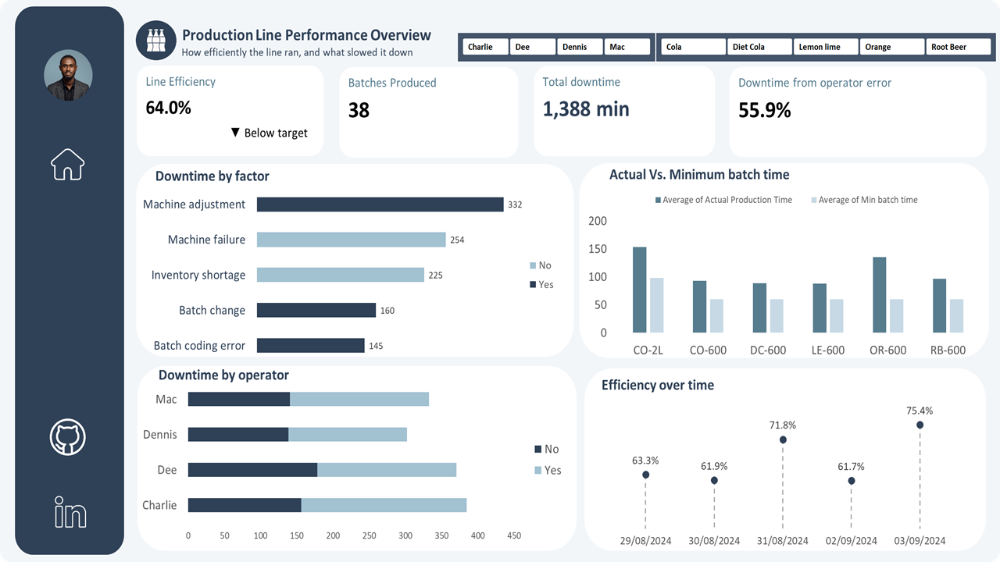
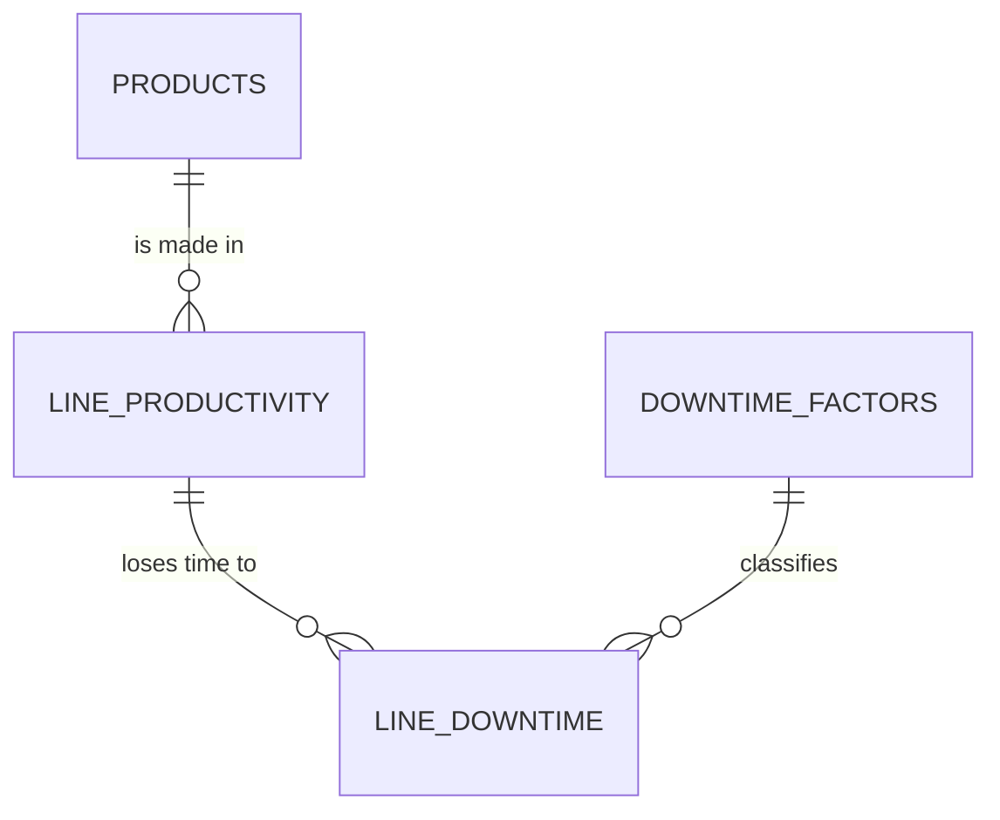

#  Manufacturing Line Productivity Analysis

**An Excel dashboard that shows where a soda bottling line loses time, why it happens, and what to fix first.**


<!-- EDIT: replace with your own dashboard screenshot saved at images/dashboard.png -->


---

## 📌 Executive Summary

A bottling line should run each batch in a set minimum time. Across 38 batches, the line needed **64.3 hours to do work that should take 41.2 hours**. That is a **line efficiency of 64%**, meaning roughly **1 hour in every 3 was lost to downtime**.

| Metric | Result |
|---|---|
| Batches analyzed | **38** (6 products, 4 operators, 5 production days) |
| Actual production time | **3,858 min** (64.3 hrs) |
| Ideal production time | **2,470 min** (41.2 hrs) |
| Total downtime | **1,388 min** (23.1 hrs), 36% of runtime |
| **Line efficiency** | **64.0%** |
| Average downtime per batch | **36.5 min** |
| Downtime events logged | **61** |

---

## 🔍 Key Findings

**1. Three causes account for almost 60% of lost time.**
Machine adjustment (332 min), machine failure (254 min) and inventory shortage (225 min) together make up **58% of all downtime**. The top five causes make up **80%**, a classic Pareto pattern, which means a short list of fixes can recover most of the lost time.

| Rank | Downtime cause | Minutes | Share | Operator error? |
|---|---|---:|---:|:---:|
| 1 | Machine adjustment | 332 | 23.9% | Yes |
| 2 | Machine failure | 254 | 18.3% | No |
| 3 | Inventory shortage | 225 | 16.2% | No |
| 4 | Batch change | 160 | 11.5% | Yes |
| 5 | Batch coding error | 145 | 10.4% | Yes |
| | *Other 6 causes* | *272* | *19.6%* | |

**2. More than half of downtime is controllable.**
**776 of 1,388 minutes (56%)** were classified as operator error (adjustments, batch changes, coding and calibration mistakes). These are the most fixable losses, through training, checklists and standard procedures, rather than capital spending.

**3. The upside is large.**
If operator-error downtime were eliminated, line efficiency would rise from **64% to about 80%**. Even *halving* it would lift efficiency to roughly **71%**.

**4. Operators and products perform similarly.**
Efficiency by operator ranges from 61% to 67%, and by product from 62% to 68% (for products with more than one batch). The gaps are small and each operator ran only 8 to 11 batches, so the data points to **process-level problems, not individual performance**.

| Operator | Batches | Efficiency | Downtime (min) | Share from operator error |
|---|---:|---:|---:|---:|
| Charlie | 11 | 66.8% | 384 | 59% |
| Dee | 11 | 64.1% | 370 | 52% |
| Dennis | 8 | 63.2% | 302 | 54% |
| Mac | 8 | 61.0% | 332 | 58% |

**5. Only 3 of 38 batches ran perfectly.**
Just three batches (8%) hit the minimum time with zero downtime. The worst single batch (422147, a 2 L cola run) lost **107 minutes**, more than the 98 minutes the batch was meant to take.

---

## 💡 Recommendations

1. **Standardize machine adjustments.** The most frequent (12 events) and costliest cause, and operator-driven. A setup checklist or guided procedure is the highest-impact first step.
2. **Review preventive maintenance.** Machine failure is the largest cause outside operator control (254 min across 11 events).
3. **Fix the inventory pipeline.** 225 minutes were lost waiting for materials. Stock checks before each batch would prevent most of it.
4. **Tighten batch changeovers and coding.** Together 305 min lost, all operator-controlled.
5. **Track the 3 perfect batches.** Document what conditions made them run clean and use them as the benchmark.

---

## 📊 The Dashboard

<!-- EDIT: adjust this list so it matches the views in your workbook -->
The Excel dashboard turns the raw production logs into a one-page view for plant managers:

- **Headline KPIs:** efficiency, total downtime, average downtime per batch
- **Downtime by cause:** ranked to show which problems matter most
- **Operator error vs. other causes:** how much loss is controllable
- **Operator and product comparison:** efficiency side by side

Open `Manufacturing_Line_Productivity.xlsx` and go to the dashboard sheet.

---

## 🗂️ Data

The workbook contains four related tables (full field definitions in [`data_dictionary.csv`](data_dictionary.csv)):

| Table | Type | Rows | Purpose |
|---|---|---:|---|
| Line productivity | Fact | 38 | One row per batch: date, product, operator, start and end time |
| Line downtime | Fact | 38 | Minutes lost per batch, split across 12 downtime causes |
| Products | Dimension | 6 | Flavor, size and the minimum possible batch time |
| Downtime factors | Dimension | 12 | Cause description and whether it is operator error |



---

## 🧮 How the Metrics Work

| Metric | Plain-English meaning | Calculation |
|---|---|---|
| **Batch duration** | How long the batch actually took | End time − Start time (handles batches crossing midnight) |
| **Ideal time** | How long it should take with no problems | Product's minimum batch time (60 min for 600 ml, 98 min for 2 L) |
| **Downtime** | Minutes lost to a problem | Sum of minutes logged against all 12 causes |
| **Line efficiency** | How much of the time was productive | Ideal time ÷ Actual duration |
| **Operator-error downtime** | Lost time the team could have prevented | Downtime from causes flagged "Yes" |

> ✅ **Data integrity check:** for **all 38 batches**, logged downtime equals actual time minus minimum time exactly. The downtime log fully explains every lost minute, so the numbers above can be trusted.

---

## 🧹 Data Preparation

The raw workbook needed reshaping before analysis: a two-row header, a wide downtime table with 12 cause columns, and a batch that ran past midnight. Every issue, decision and validation check is documented in **[`docs/data_cleaning.md`](docs/data_cleaning.md)**.

---

## ⚠️ Limitations

- **Small sample:** 38 batches over 5 days. Findings are directional, not statistically conclusive.
- **Operator comparisons are indicative only,** because operators worked different products and times of day.
- **OR-600 (orange) had a single batch,** so its 44% efficiency should not be generalized.
- **"Operator error" labels come from the source data** and were not independently audited.

---

## 📁 Repository Structure

```
manufacturing-line-productivity/
├── README.md                              ← you are here
├── Manufacturing_Line_Productivity.xlsx   ← data + dashboard
├── data_dictionary.csv                    ← field definitions
├── data/
│   └── raw/
│       └── Manufacturing_Line_Productivity_RAW.xlsx   ← original, untouched
├── docs/
│   └── data_cleaning.md                   ← cleaning log and validation
└── images/
    └── dashboard.png                      ← dashboard screenshot
```

## 🚀 How to Use

1. Download `Manufacturing_Line_Productivity.xlsx`
2. Open it in Excel and go to the dashboard sheet
3. Use any slicers or filters to explore by product, operator or date
4. To add new data, append rows to the source tables and choose **Data → Refresh All**

## 🛠️ Skills Demonstrated

Data cleaning and reshaping · Data modeling (fact and dimension tables) · KPI design · Pareto analysis · Root-cause analysis · Data validation and reconciliation · Dashboard design · Translating data into business recommendations

---

## 👤 Author

**[Olaonipekun Hammed]** · [LinkedIn](linkedin.com/in/olaonipekun-hammed/) · [Email](mailto:olaonipekunhammed08@gmail.com)
